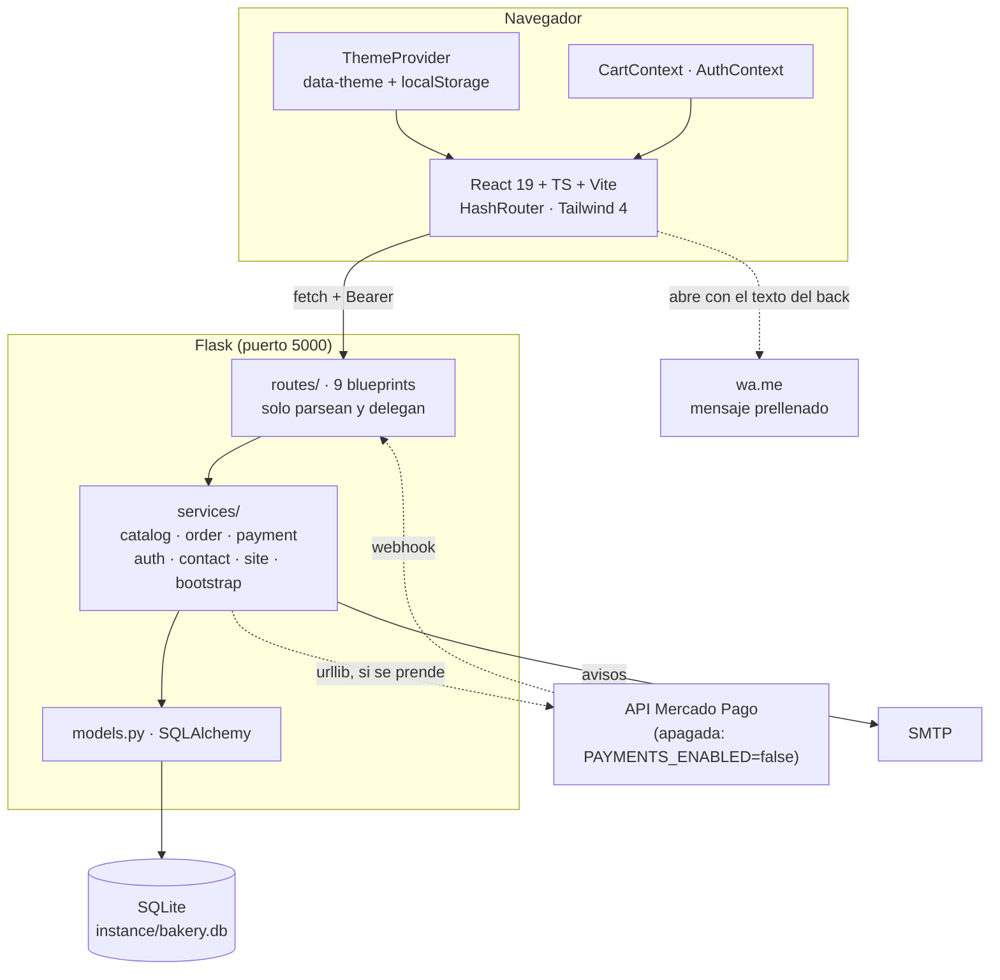
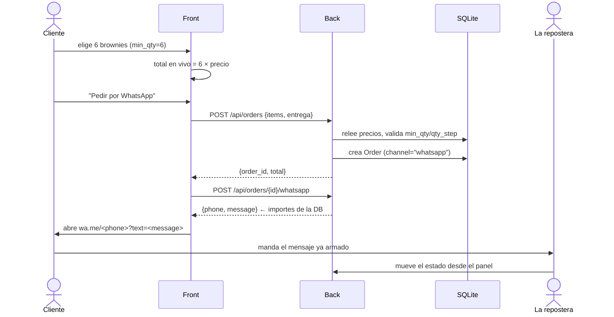
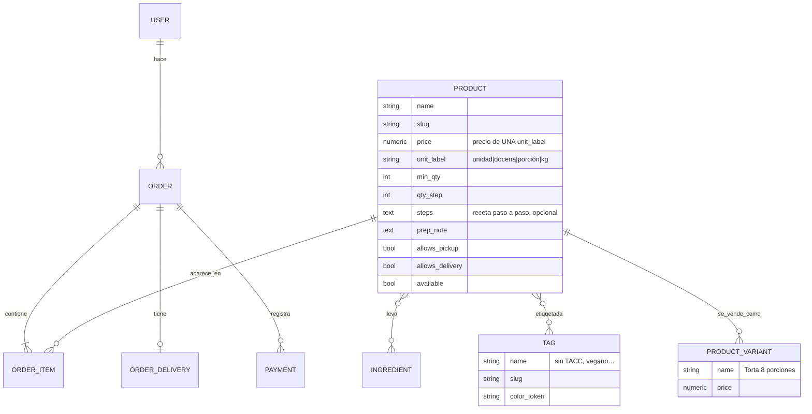

# diagram.md · Andres Bakery

**Versión:** 0.1.0 · **Última actualización:** 2026-10-16

## 1 · Arquitectura

## 2 · Flujo del pedido por WhatsApp (ADR-002)

El mensaje lo arma el **back** a propósito: el texto que lee ella y los importes de la DB salen de la misma fuente y no pueden divergir.

## 3 · Modelo de datos objetivo (T3)

`RECIPE` no está en el diagrama: se jubila por ADR-001. `INGREDIENT` y su m2m con `PRODUCT` **ya existen** en el código — hoy sin uso.
